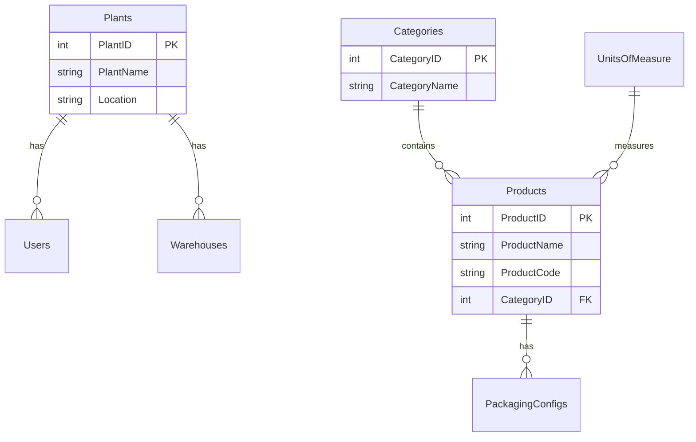
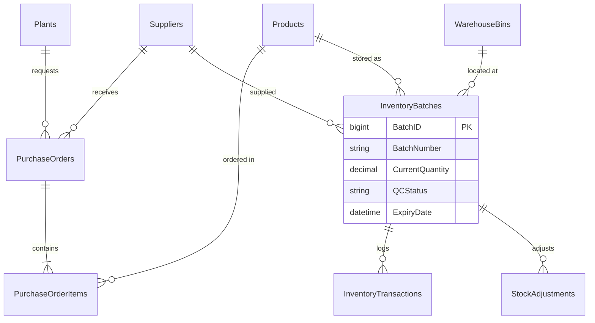
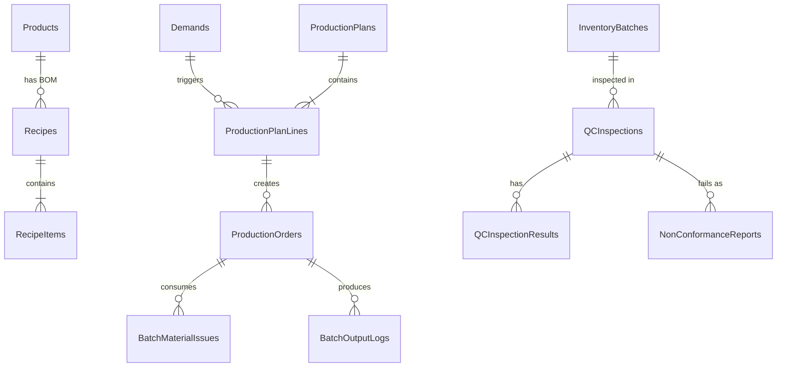
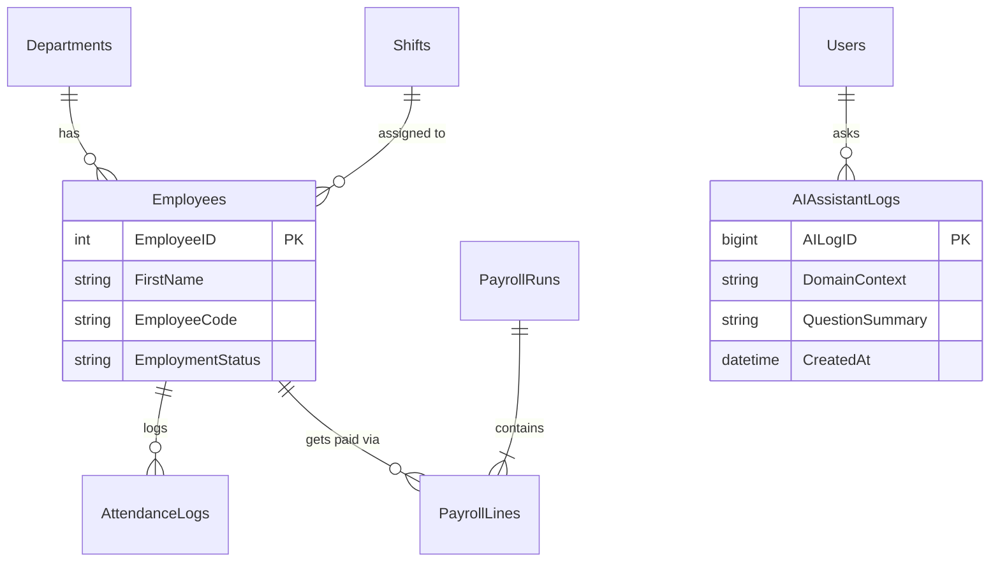

# 🏭 FoodOps ERP - Food Manufacturing Suite


A robust, enterprise-grade Food Manufacturing ERP system built using **ASP.NET Core MVC (.NET 10)** with **Razor Views (Server-Side Rendering)** on the backend, integrated with **EF Core 10 & SQL Server**. The frontend features a highly customized **Fluent Design SPA Dashboard** powered by **Vanilla JS, Bootstrap 5, and Custom CSS**. The system also integrates **Google Gemini AI** for real-time database querying and operational insights.

---
### 📂 Backend Project Breakdown

The backend is built as a **Single ASP.NET Core MVC Project** with strict folder-level separation of concerns. This eliminates cross-project dependency issues while maintaining Clean Architecture principles.

*   **`Controllers/` (Presentation):** Handles HTTP requests, routing, and returns Razor Views. Organized into sub-folders like `Executive`, `Manufacturing`, `SupplyChain`, etc., for modular routing.
*   **`Services/` (Business Logic):** The core engine of the ERP. Contains interfaces and implementations for Inventory, Production, HR, and **AI Integration**. Decoupled from the database.
*   **`Data/` (Data Access):** Houses the `ApplicationDbContext` and EF Core configurations. Handles all database migrations and relationships.
*   **`Models/` (Domain Entities):** Contains database Entities (Database tables) and ViewModels (Data transfer objects for the UI).
*   **`Infrastructure/`:** Contains cross-cutting concerns like `AppController` (Base controller), `GridHtml.cs` (Custom Razor helpers for dynamic tables), and custom View Location Expanders.
*   **`Middlewares/`:** Custom Global Exception Handling Middleware to catch and log unhandled errors gracefully.

---

### 🎨 Frontend Integration

The frontend is not a separate SPA project (like React or Angular), but rather a highly customized **Server-Side Rendered (SSR) Application** using **Razor Views (.cshtml)** and **Vanilla JavaScript**.

*   **Razor Views:** The UI is rendered on the server and delivered as complete HTML. However, our custom `spa-router.js` intercepts link clicks and fetches only the inner HTML, providing a seamless Single Page Application (SPA) feel without any full-page reloads.
*   **Custom UI Engine (`wwwroot/`):** 
    *   `site.css`: Contains our custom Fluent Design System tokens, overriding standard Bootstrap.
    *   `ui.js` / `shell.js`: Handles interactive elements like dynamic modals, toasts, grid searching/sorting, and sidebar state management.
*   **Zero-Build Step:** Unlike React (which requires Webpack/Vite build steps), our frontend runs directly from the `wwwroot` directory, making deployment incredibly fast and lightweight.


---

## 🗄️ Database Entity-Relationship (ER) Diagrams

To keep the diagrams readable and comprehensive, the database model is categorized into logical modules. These diagrams are written in **Mermaid.js** syntax and render natively.

### 1. Master Data & Catalog (Core)
Tracks the basic master records that populate the rest of the business documents.



### 2. Supply Chain & Inventory (Procurement)
Manages trade transactions with Suppliers and tracks real-time stock batches.



### 3. Manufacturing & Quality Control
Handles Recipes (BOM), Production Orders, and strict Quality Inspections.



### 4. Workforce & AI Engine
Manages HR, Payroll, and logs AI interactions.



---

## 🛡️ Security, Policies, and Audit Trails

### Authentication & Authorization
The application is secured using **Cookie-Based Authentication** and strict **Role-Based Access Control (RBAC)** at the Controller level.

*   **RBAC Enforcement:** Controllers are decorated with `[Authorize(Roles="...")]`. For example, only users with the `HR Manager` or `Administrator` role can access the `Workforce` module.
*   **Anti-Forgery Protection:** All POST requests (Forms/AJAX) are protected using `@Html.AntiForgeryToken()` and verified via the `RequestVerificationToken` header to prevent CSRF attacks.

### Automated Auditing Mechanism
The system features an automated, transactional auditing design at the database level using EF Core:

*   **Audit Columns:** Almost all critical tables contain `CreatedAt`, `CreatedByUserID`, `ModifiedAt`, and `ModifiedByUserID` columns to track *who* did *what* and *when*.
*   **Concurrency Control:** `RowVersion` (Timestamp) is applied on all tables to prevent data overwrites during simultaneous user edits.
*   **AI Audit Logs:** Every AI interaction is tracked in the `AIAssistantLogs` table, storing the `DomainContext`, `QuestionSummary`, and `ExecutionTimeMs` for performance and usage monitoring.
*   **Append-Only Logs:** Tables like `ProductionStatusHistory` and `InventoryTransactions` are designed as immutable logs (no updates or deletes allowed) for strict traceability.
```


